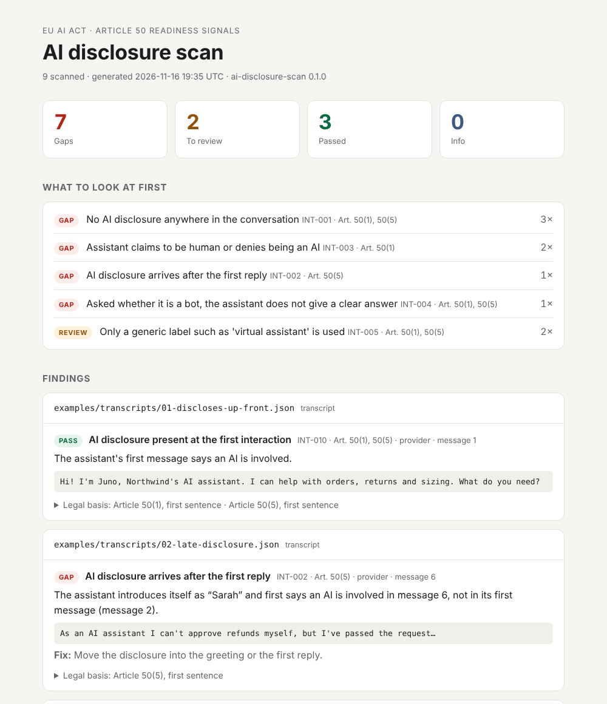

# ai-disclosure-scan

[](https://github.com/pyroplast/ai-disclosure-scan/actions/workflows/ci.yml)

A command-line check for the transparency duties in **Article 50 of the EU AI Act**: does your chatbot tell people it is an AI, at the right moment, and is your AI-made content marked and labelled?

Every finding names the exact sentence of the Act it rests on, with a link, so you can check the tool against the law instead of trusting it.



No dependencies, no model API, no account. Python 3.9+.

> **Not legal advice.** This is a technical readiness check. It reports signals a script can see. Whether a duty applies to you, and whether you meet it, needs a person who knows your system.

## Why this exists

Article 50 has applied since 2 August 2026. In short, it asks for four things:

| Paragraph | Who | What |
|---|---|---|
| 50(1) | Providers | Tell people they are interacting with an AI system, unless that is obvious |
| 50(2) | Providers | Mark AI-generated audio, image, video and text in a machine-readable, detectable way |
| 50(3) | Deployers | Tell people when emotion recognition or biometric categorisation is used on them |
| 50(4) | Deployers | Label deep fakes, and AI-written text that informs the public on matters of public interest |

Article 50(5) adds the how: clearly and distinguishably, at the latest at the first interaction or exposure, and accessibly. Fines can reach €15 million or 3% of worldwide annual turnover ([Commission FAQ](https://digital-strategy.ec.europa.eu/en/faqs/transparency-obligations-under-article-50-ai-act)).

Most of this can only be judged by people. A useful part of it can be tested by a script on every release, the same way you test anything else. That part is what this tool does.

## Install

```bash
pipx install git+https://github.com/pyroplast/ai-disclosure-scan
# or, from a clone:
pip install -e .
```

## Three scans

### 1. Conversations: does the assistant say it is an AI, and when?

Export conversations from your chatbot (JSON, JSONL or plain text) and scan them.

```bash
ai-disclosure-scan transcript examples/transcripts/
```

```text
examples/transcripts/02-late-disclosure.json  (transcript)
  GAP    INT-002  AI disclosure arrives after the first reply  [Art. 50(5)]  @ message 6
         The assistant introduces itself as “Sarah” and first says an AI is involved in message 6, not in its first message (message 2).
         evidence: As an AI assistant I can't approve refunds myself, but I've passed the request…
         fix: Move the disclosure into the greeting or the first reply.
         basis: Article 50(5), first sentence [law]; Question 'When do providers of AI systems have to inform people they are interacting with an AI system?' [official guidance]

examples/transcripts/03-claims-to-be-human.txt  (transcript)
  GAP    INT-003  Assistant claims to be human or denies being an AI  [Art. 50(1)]  @ message 2
         The assistant says it is a person, or denies being a machine.
         evidence: Hi there! I'm a real person, don't worry. How can I help you today?
```

It understands eight languages (English, Spanish, German, French, Italian, Portuguese, Dutch, Polish), and it knows that "I'm not a bot" is a denial, not a disclosure.

If your chat UI shows a visible AI notice outside the message stream, pass `--ui-notice` and the first-message check is skipped. Human claims are still reported.

### 2. Web pages: is there a chat widget, and does the page say it is an AI?

```bash
ai-disclosure-scan page https://example.com
ai-disclosure-scan page examples/sites/northwind-bad    # a local file works too
```

The scan recognises 34 chat and voice widgets by their script signatures, looks for a clear AI notice in the visible text, separates it from wording hidden in `aria-label`, `display:none` or metadata, and inspects the media on the page for AI marking and a visible AI label.

A page scan is static: it does not run JavaScript and cannot open the widget. So page findings about chat are always `REVIEW`, never `GAP`. To get a firm answer, export a conversation and run the transcript scan.

### 3. Media files: is the AI origin marked in a machine-readable way?

```bash
ai-disclosure-scan media examples/media/
```

```text
examples/media/generator-trace.png  (media)
  GAP    MED-001  AI-generator traces, but no standard machine-readable AI marking in the metadata  [Art. 50(2)]
         evidence: Generator traces: Stable Diffusion web UI parameters

examples/media/marked-iptc.jpg  (media)
  PASS   MED-002  Standard machine-readable AI marking present  [Art. 50(2)]
         evidence: IPTC Digital Source Type = trainedAlgorithmicMedia
```

It reads C2PA manifests (Content Credentials) and the IPTC Digital Source Type from JPEG, PNG, WebP, MP4/MOV, HEIF/AVIF, WAV and MP3 containers, plus tool-specific generator traces. It parses the containers itself, so it needs no image library.

## Reports

```bash
ai-disclosure-scan transcript chats/ --format html -o report.html
```

`--format` is `text` (default), `json`, `md` or `html`. The HTML report is one self-contained file. Sample reports are in [`examples/reports/`](examples/reports).

Findings come in four kinds:

| Status | Meaning |
|---|---|
| `GAP` | A concrete signal that a duty is probably not met |
| `REVIEW` | A person has to look; the scanner cannot decide |
| `PASS` | The signal the duty calls for was found |
| `INFO` | Context, or something the scanner cannot assess |

## Check the basis yourself

Each rule lists:

- the **pinpoint**: paragraph and sentence of Article 50, or the question in the Commission's FAQ
- a **paraphrase** of what that place says
- a **link** to the source
- the **weight** of the source: `law`, `official guidance`, `voluntary code` or `secondary summary`
- the **scanner's reading**: the step from the provision to what a script can observe, labelled as this tool's interpretation and not the law

You see this in every report format, in `ai-disclosure-scan rules`, and in [docs/article-50-mapping.md](docs/article-50-mapping.md), which is generated from the catalogue and checked by a test so it cannot drift from the code.

Two rules (`INT-005`, `PAGE-004`) lean partly on a law firm's summary of the Commission Guidelines, because this project has not verified that point against the Guidelines text. They are marked `secondary summary` and produce `REVIEW`, never `GAP`.

## Use it in CI

Keep a few exported conversations as a regression set and fail the build when the disclosure breaks:

```yaml
- run: pipx install git+https://github.com/pyroplast/ai-disclosure-scan
- run: ai-disclosure-scan transcript tests/conversations/ --fail-on gap
```

Exit codes: `0` nothing at the chosen level, `1` findings at or above `--fail-on` (`gap` by default, or `review`, or `never`), `2` nothing could be scanned.

## What it cannot see

- Anything that needs a browser: notices rendered by JavaScript, the inside of a chat widget, where a notice sits on the screen.
- Invisible watermarks such as SynthID. Only the vendor's detector reads those, so "no metadata marking" is not "no marking".
- Whether a C2PA signature is valid. It reads the manifest; it does not verify it.
- Whether media is a deep fake in the sense of Article 3(60), whether text is on a matter of public interest, and whether any exception applies. Those are judgements.
- Article 50(3), emotion recognition and biometric categorisation. Not covered.
- Voice calls. Transcripts of them can be scanned as text.

More detail in [docs/limitations.md](docs/limitations.md).

## Scanning sites you do not own

The page scan sends one request for the page and up to 12 for its media, identifies itself in the user agent, and respects `robots.txt` unless you pass `--ignore-robots`. A static scan of someone else's site tells you what to look at, not what they did wrong: please do not publish claims about a named company on the strength of a `REVIEW` finding.

## How it is built

- Standard library only. HTML via `html.parser`, HTTP via `urllib`, media containers parsed by hand.
- 124 tests, run on Python 3.9, 3.11 and 3.13. They cover the phrase lists in all eight languages, every container format, the HTML visibility rules, a real HTTP round trip with `robots.txt`, and the legal mapping itself: every rule must cite the Act, and the paragraphs in its header must match the ones its basis points at.
- The example sites, conversations and images are made up. The images are gradients drawn by [`scripts/make_examples.py`](scripts/make_examples.py); only their metadata imitates what real tools write.

## Sources

- [Regulation (EU) 2024/1689, Article 50](https://ai-act-service-desk.ec.europa.eu/en/ai-act/article-50), consolidated text of 27 July 2026 (European Commission, AI Act Service Desk). Official journal text: <https://eur-lex.europa.eu/eli/reg/2024/1689/oj>
- [Commission FAQ on Article 50](https://digital-strategy.ec.europa.eu/en/faqs/transparency-obligations-under-article-50-ai-act)
- [Commission Guidelines on Article 50](https://digital-strategy.ec.europa.eu/en/library/guidelines-transparency-obligations-providers-and-deployers-ai-systems), 20 July 2026
- [Code of Practice on marking and labelling of AI-generated content](https://digital-strategy.ec.europa.eu/en/policies/code-practice-ai-generated-content), 10 June 2026 (voluntary)

For systems placed on the market before 2 August 2026, the marking and detection duty in Article 50(2) applies from 2 December 2026 (Commission FAQ).

## Roadmap

- Optional headless-browser mode that opens the widget and reads its first message
- C2PA signature validation
- Detection of the EU labelling icons
- More languages and more widget signatures (both are plain lists in [`lexicon.py`](src/ai_disclosure_scan/lexicon.py); pull requests welcome)

## Licence

MIT. Built by Pavlo Rodionov.
